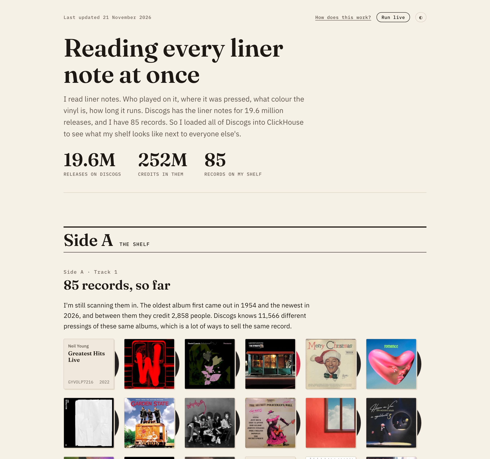

# Every liner note

I wanted to know what my record shelf looks like next to everything else on vinyl. So I loaded the whole Discogs catalogue into ClickHouse and asked it. This repo builds a static page out of the answers. Every number on it comes from a SQL query you can open, copy, and, if you connect a ClickHouse of your own, run again.

You can see it at [records.tylerhannan.com](https://records.tylerhannan.com/).

<picture>
  <source media="(prefers-color-scheme: dark)" srcset="docs/screenshot-dark.jpg">
  
</picture>

## Set up

You need three things.

### ClickHouse

Install it first, following [ClickHouse's install guide](https://clickhouse.com/docs/install), and make sure `clickhouse --version` works. One binary covers everything here: the build runs it as `clickhouse local`, and live mode runs it as a server.

The quickest way is `curl https://clickhouse.com/ | sh`, which downloads that single `clickhouse` binary into the current folder. Move it somewhere on your PATH, such as `/usr/local/bin`. You don't need `clickhouse install` afterwards: that sets up a system-wide server, and this repo brings its own config.

### discogskit

This turns the Discogs XML dump into Parquet.

```bash
uv tool install discogskit            # or: pipx install discogskit
```

### Python 3

You probably have it already.

[Ollama](https://ollama.com) with `gemma3:4b` is optional. You only need it to rerun the AI step.

## Build it

```bash
./build.sh --dump 20261101   # first time: download and load that month's dump (12 GB, give it a while)
./build.sh                   # after that: rebuild the page in about 30 seconds
open web/index.html
```

Discogs posts a new dump each month. Swap in the date and rebuild.

## Use your own collection

Export your collection from Discogs (Collection → Export), drop the CSV (or the zip Discogs sends) in the repo root, and run `./build.sh --ai`. The build uses the newest one it finds. The `--ai` part writes notes about the people on your records and sorts the vinyl colours, which needs Ollama running. It only asks the model about what it hasn't seen before, so a rebuild with a few new records is quick. Add `--fresh` to redo everything. Every build also looks up new records on MusicBrainz for their covers, a second or two each, so your first build takes a few minutes longer.

Every number, chart, and list comes from your shelf. The title, the closing lines, and the link preview tags at the top are mine, so change those in `web/index.html`.

## Run it live

On [the live page](https://records.tylerhannan.com/), press **Run live** and then **Use my ClickHouse Cloud**. That connects to my Cloud service as a read-only user, with nothing to type. Each SQL panel gets its own Run live button, and you can edit the SQL first. Some sections redraw from what comes back: try `LIMIT 5` on the running time at the bottom.

To run it against your own laptop instead:

```bash
./dev/live.sh
```

That starts ClickHouse as a server on `localhost:8123`, with a read-only user. Press **Run live**, open **Or connect your own ClickHouse**, and connect as `web` with the password `vinyl-local`. Stop the server (Ctrl-C) before running `./build.sh` again, since they can't share the data folder.

### Your own ClickHouse Cloud

This is how mine is set up, with [clickhousectl](https://clickhouse.com/docs/interfaces/cli) logged in with an API key.

```bash
clickhousectl cloud service create --name every-liner-note      # then wait for it to be running
export CH_SERVICE=every-liner-note
./ingest/load_cloud.sh 20261101     # the Discogs tables from this repo's data release, plus your shelf
./ingest/cloud_web_user.sh          # the public read-only user; it prints the password
```

Put the service's HTTPS endpoint and that password in `PUBLIC` at the top of `web/live.js`. The password ends up in the page on purpose: the user can only read the `discogs` tables, for 20 seconds a query, within an hourly quota per visitor.

For a newer dump, load it with `./build.sh --dump 20261201`, write its Parquet files with `./ingest/export_parquet.sh 20261201`, and put them in a release with `gh release create data-20261201 data/release/20261201/*.parquet`.

## Things to try live

With the page connected, open a section's SQL, change one line, and press Run live. These are good ones to start with.

| Section | Change | What happens |
|---|---|---|
| A2, genres | `year >= 2015` to `year BETWEEN 1970 AND 1979` (it's in there twice) | My shelf against 1970s vinyl. The heading changes from Stage & Screen to Electronic. |
| B1, reissues | `>= 10` to `>= 20` | A reissue has to be 20 years after the album. 2025 goes from 29.9% reissues to 24.1%. |
| C1, the people | `HAVING families >= 2` to `>= 3` | Only people on records by three or more of my artists. Mine's down to Bob Dylan. |
| C2, search | type part of a name | ClickHouse reads every name on Discogs and lists the 10 most credited matches, then the first one's credits by role and decade. |
| C2, search | `ILIKE concat('%', {name:String}, '%')` to `ILIKE concat({name:String}, '%')` | Only names that start with what you typed. "steve" gets Steve Winwood, Steve Cropper, and Steve Harris first. |
| C2, one person | add `AND c.scope IN ('release_extra', 'track_extra')` after `WHERE c.artist_id = {artist_id:UInt32}` | Only the liner-note credits. For Bob Dylan, Main artist drops out (26,008 credits) and harmonica makes his top four. |
| D1, buy next | `ORDER BY from_my_records DESC, shared_people DESC` to `ORDER BY shared_people DESC, from_my_records DESC` | Ranks by head count instead. Taylor Swift comes first and second. |
| D1, buy next | `<= 500` to `<= 5000` | Lets in the people who are on everything. Beatles solo records take over, led by *McCartney III Imagined* from 9 of my records. |
| B2, colours | add `AND has(r.genres, 'Classical')` after `c.colour != 'not a colour'` | Only classical limited editions. The most common colour changes. |
| Hidden track, how long | add `LIMIT 5` at the end | The running time of my five longest records (8 hours), and when I'd finish. |
| Hidden track, how long have you got | type a number of minutes | ClickHouse tries every combination of up to four records and picks the best fit. |

If an edit drops a column a section needs, the page says so and stays put.

## Publish it

`web/` is the whole site. Put it on GitHub Pages or anywhere else that serves static files.

## Credits

Catalogue data comes from the [Discogs monthly data dumps](https://data.discogs.com/), released under CC0. Most cover images come from the [Cover Art Archive](https://coverartarchive.org/), matched through [MusicBrainz](https://musicbrainz.org/) at build time. The rest come from the Discogs API as they scroll into view, and aren't kept for more than six hours.

This application uses Discogs' API but is not affiliated with, sponsored or endorsed by Discogs. 'Discogs' is a trademark of Zink Media, LLC.
